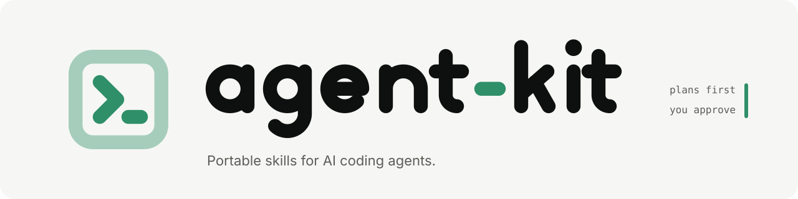

<p align="center">
  <picture>
    <source media="(prefers-color-scheme: dark)" srcset="assets/brand/banner-dark.svg" />
    
  </picture>
</p>

<p align="center">
  <a href="#skills"><b>Skills</b></a> ·
  <a href="#install">Install</a> ·
  <a href="#use">Use</a> ·
  <a href="CHANGELOG.md">Changelog</a>
</p>

Skills for Claude Code and any agent that reads `SKILL.md`. Every skill:

- plans first, writes nothing until you approve, and asks again before each milestone;
- keeps milestones to about 8 steps, each with its own check;
- runs repeated jobs in one pass, never once per case, and saves the fastest method in your project.

## Skills

| Skill | Does |
|---|---|
| [`architect`](skills/architect/SKILL.md) | Designs a project's architecture, records it as ADRs (`docs/adr/`) and agent rules (`.claude/rules/architecture/`), then builds or migrates it milestone by milestone. |
| [`reverse-engineer`](skills/reverse-engineer/SKILL.md) | Sets up a reverse-engineering project for a game or app, maps its systems, then takes the fastest route: local server emulator, asset extractor or rewrite. Local only, nothing proprietary in git. |

## Install

Copy a skill folder into `~/.claude/skills/` for every project, or a project's `.claude/skills/` for that one only.

```bash
cp -r skills/architect ~/.claude/skills/
```

## Use

Ask in plain words ("plan the architecture for…") or call it:

```
/architect a 2D roguelike in Godot
/architect restructure this repo
/reverse-engineer an old MMO I have installed, to run it on a local server
```

## License

MIT. See [LICENSE](LICENSE).
